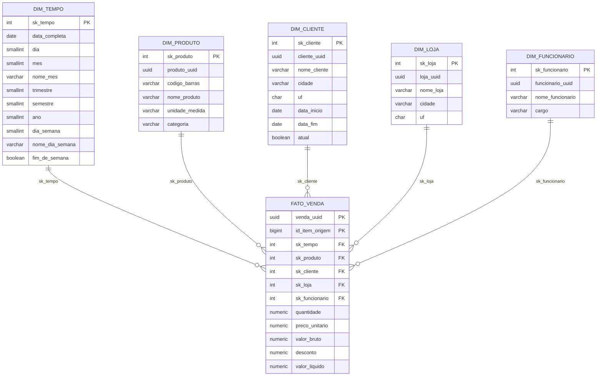
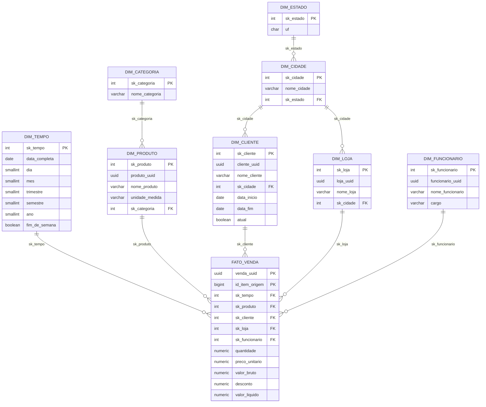

# Data Warehouse - Supermercado (BD2)

## 1. Arquitetura e Granularidade
- **Schemas:** `stg` (Staging), `etl` (controle e auditoria), `dw_estrela` (Star Schema) e `dw_floco` (Snowflake Schema).
- **Granularidade da Fato:** 1 linha por item vendido (`public.sale_items`) pertencente a vendas concluidas (`status = 'COMPLETED'`).
- **Medidas:** `quantidade`, `preco_unitario`, `valor_bruto`, `desconto` e `valor_liquido`.
- **SCD Tipo 2:** Aplicado na dimensao `dim_cliente` para rastrear historico de mudanca de `cidade` e `uf` (`data_inicio`, `data_fim`, `atual`).
- **Tratamento de Nulos:** Vendas sem cliente identificado sao associadas ao registro fixo `sk_cliente = 0` (`Cliente Nao Identificado`).

## 2. Diagramas Dimensionais
- **Modelo Estrela (`dw_estrela`):** `docs/dw/modelo-estrela.png`
- **Modelo Floco de Neve (`dw_floco`):** `docs/dw/modelo-floco-de-neve.png`





## 3. Execucao do ETL
```sql
-- Carga completa (recria dimensoes e fatos)
CALL etl.executar_carga(true);

-- Carga incremental (insere apenas novos itens de venda e aplica SCD Tipo 2)
CALL etl.executar_carga(false);

-- Auditoria das cargas
SELECT * FROM etl.log_execucao;
```

## 4. Comparativo de Desempenho (`EXPLAIN ANALYZE`)
Consulta analitica agregando faturamento por loja, categoria, ano e mes sobre 12.517 itens vendidos:

| Modelo | 1a Execucao | 2a Execucao (Cache) | Observacao Tecnica |
| :--- | :---: | :---: | :--- |
| **OLTP (`public`)** | 69,395 ms | 65,282 ms | Exige 4 JOINs transacionais, filtro de status, conversao de timezone e calculo aritmetico por linha |
| **Estrela (`dw_estrela`)** | 36,155 ms | 37,193 ms | Reducao de ~45% no tempo; leitura direta de chaves surrogate inteiras e medidas pre-calculadas |
| **Floco de Neve (`dw_floco`)** | 36,906 ms | 36,510 ms | Desempenho proximo ao Estrela neste volume, exigindo 1 JOIN adicional na hierarquia `dim_categoria` |