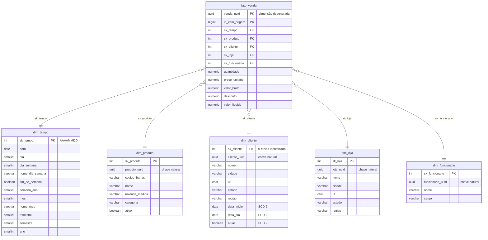
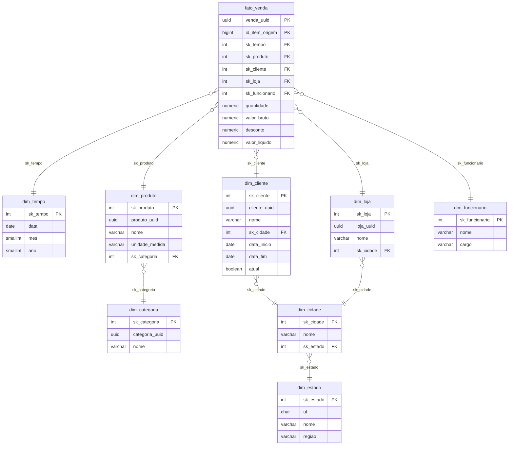
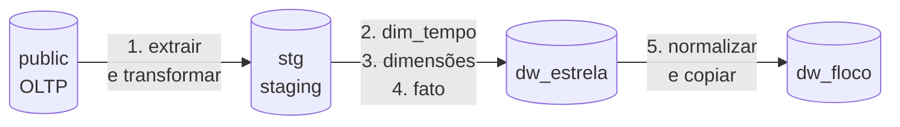

# Data Warehouse: modelos estrela e floco de neve

Scripts: `src/main/resources/db/dw/01_estrutura.sql` (tabelas) e `02_etl.sql` (ETL). Disparo: `POST /api/etl/run`.

## Decisões (plano da equipe, seção 4)

| Tema | Decisão |
|---|---|
| Granularidade | Uma linha por item vendido (`sale_items`) de venda concluída (`COMPLETED`) |
| Medidas | `quantidade`, `valor_bruto` (quantidade × preço), `desconto`, `valor_liquido` (bruto − desconto), em reais |
| Dimensões | Tempo, Produto, Cliente, Loja, Funcionário (vendedor) |
| Dimensão degenerada | `venda_uuid` (o número da venda fica no próprio fato) |
| Cliente não identificado | Membro fixo `sk_cliente = 0`: o fato nunca tem cliente nulo |
| Histórico | SCD tipo 2 na cidade/UF do cliente; tipo 1 (sobrescreve) nas demais dimensões |
| Pagamento | Fora do fato: uma venda pode ter vários pagamentos, o que quebraria a granularidade de item |
| Desconto | Sempre 0 por enquanto: o OLTP ainda não registra desconto no item |

## Modelo estrela (`dw_estrela`)

Cada dimensão é uma tabela só, ligada direto ao fato. As hierarquias ficam desnormalizadas dentro da dimensão:
a categoria está em `dim_produto`, e cidade, UF, estado e região estão em `dim_loja` e `dim_cliente`.



## Floco de neve (`dw_floco`)

As hierarquias viram tabelas próprias: produto → categoria e cliente/loja → cidade → estado. Tempo e funcionário
ficam iguais aos da estrela. Produto, cliente, loja, funcionário e tempo usam as **mesmas chaves substitutas** da
estrela, e o fato é uma cópia do fato da estrela. Os dois modelos guardam exatamente os mesmos dados, o que permite
comparar o desempenho com justiça.



## Fluxo do ETL (`CALL etl.executar(completa)`)



| Passo | Procedure | O que faz |
|---|---|---|
| 1 | `etl.extrair` | Esvazia o staging e copia do OLTP. Dimensões por inteiro; itens de venda **só os que faltam no DW** (carga incremental). Padroniza textos (espaços, UF), troca nulos por "Não informado", traduz códigos (`CASHIER` → "Caixa", `KG` → "Quilograma") e calcula as medidas (centavos → reais) |
| 2 | `etl.carregar_dim_tempo` | Gera todos os dias dos anos que as vendas cobrem, com nomes em português |
| 3 | `etl.carregar_dimensoes_tipo1` / `etl.carregar_dim_cliente` | Upsert de produto, loja e funcionário (SCD 1). Cliente com SCD 2: cidade/UF mudou → fecha a versão atual e abre outra a partir de hoje |
| 4 | `etl.carregar_fato_estrela` | Troca os uuids pelas chaves substitutas (o cliente na versão válida no dia da venda) e insere. Se algum item não virar linha do fato, desfaz a carga inteira |
| 5 | `etl.carregar_floco` | Monta estado, cidade e categoria, copia as dimensões com as mesmas chaves e copia as linhas novas do fato |

Garantias:
- **Tudo ou nada.** A execução é um único `CALL`: se qualquer passo falhar, nada muda no DW.
- **Uma execução por vez.** Um *advisory lock* serializa execuções simultâneas.
- **Idempotência.** Rodar duas vezes seguidas não duplica nada: a segunda execução insere 0 linhas.
- **Histórico.** Cada execução fica registrada em `etl.execucao`.

## Conferência

```sql
-- Os três modelos devem bater (contagem e total)
SELECT 'oltp', count(*), sum(round(i.quantity * i.unit_price_in_cents) / 100.0)
  FROM sale_items i JOIN sale s ON s.id = i.sale_id WHERE s.status = 'COMPLETED'
UNION ALL SELECT 'estrela', count(*), sum(valor_liquido) FROM dw_estrela.fato_venda
UNION ALL SELECT 'floco',   count(*), sum(valor_liquido) FROM dw_floco.fato_venda;
```

Com o seed atual: 12.467 itens e R$ 164.751,70 nos três.
